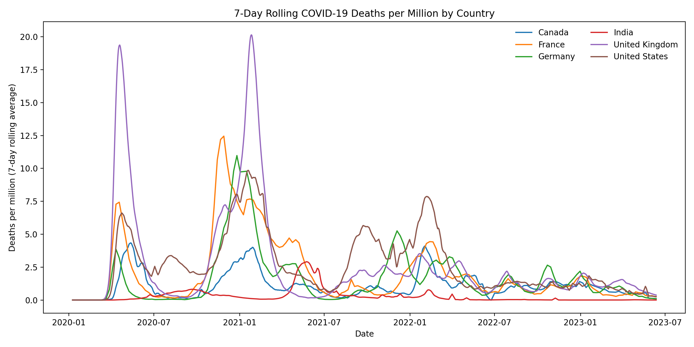

# COVID-19 mortality patterns across six countries

A Python time-series analysis comparing reported daily COVID-19 deaths per million in Canada, France, Germany, India, the United Kingdom and the United States. It combines data preparation, rolling metrics, wave detection, country summaries and exploratory clustering with charts and an HTML dashboard.

The analytical question is how reported mortality patterns differ across these six series. This is a historical comparison; it does not establish the causes of differences between countries.



## Explore the work

- [Interactive HTML dashboard](dashboard/covid_dashboard.html): download and open locally in a browser
- [Case study](reports/case_study.md) and [executive summary](reports/executive_summary.md)
- [Notebook](notebooks/covid_mortality_analysis.ipynb)
- [Preparation code](src/data_prep.py) and [summary calculations](src/analysis.py)
- [SQL examples and field mapping](sql_analysis/README.md)

## Data and reproduced findings

The included raw file contains **7,506 records** across **six countries**, with dates from **9 January 2020 to 12 June 2023** overall. The October 2026 check ran the preparation and summary functions on that file using temporary outputs, preserving the saved results.

| Measure | Reproduced result |
| --- | --- |
| UK cumulative sum of daily deaths per million | 3,347.9 |
| US cumulative sum of daily deaths per million | 3,318.7 |
| France: days from main peak to first value at or below 25% of peak | 171 |

These values describe the supplied series and definitions. The source publisher, original extraction and reuse terms are not fully documented in this repository and require confirmation before external reuse. The review reproduced calculations, not the underlying mortality reporting.

## Method

1. Sort observations by country and date and derive date fields.
2. Calculate a seven-observation rolling mean with `min_periods=1`, daily changes and cumulative summaries.
3. Detect peaks with a minimum separation of 45 observations and prominence based on each country's maximum rolling value.
4. Define recovery as the first post-peak value at or below 25% of that peak. This is an analytical threshold, not a medical definition.
5. Standardise six summary features and apply three-cluster K-means with seed 42 and 20 initialisations.

The clustering has only six country-level observations and is exploratory. Missing recovery intervals are median-imputed for clustering inputs only, with a missingness indicator; reported recovery fields remain missing. If all recovery observations are unavailable, the pipeline raises an explicit error. The row-based rolling window assumes daily observations; the validation tests check duplicate dates and daily spacing in the supplied source. Reporting practices, missing data, revisions and population denominators limit cross-country interpretation. No causal or policy-effectiveness claims are supported by this analysis alone.

## Setup and execution

From the repository root, create and activate a Python virtual environment, then:

```bash
python -m pip install -r requirements.txt
python src/data_prep.py
python src/analysis.py
```

Run from the repository root because these scripts use working-directory-relative default paths. The commands overwrite `data/processed/covid_deaths_enriched.csv` and `data/processed/country_summary.csv`; preserve copies when comparing results. They do not regenerate the HTML dashboard, every figure or the annual/monthly summary CSVs. The notebook contains additional analysis and was not rerun end to end in this review.

For interactive exploration:

```bash
jupyter notebook notebooks/covid_mortality_analysis.ipynb
```

No API keys are needed. Python 3.12 was used for the review. The requirements specify minimum versions rather than a locked environment.

## Validation

```bash
python -m unittest discover -s tests -v
```

Tests check source schema, country/date uniqueness, daily spacing, finite numeric values, country-isolated rolling calculations, cumulative totals and the recovery-threshold definition. They write only temporary outputs. See [verification notes](VERIFICATION.md) for the measured run and its limits.

## Project contents

`data/` contains raw and processed CSVs; `src/` contains pipeline scripts; `notebooks/`, `visuals/`, `dashboard/`, `reports/` and `sql_analysis/` retain the existing analysis assets. No licence, dataset or historical result was changed during this review.

Future work includes confirming source attribution and terms, recording dependencies in a reproducible environment and adding a single documented build for every published asset.
